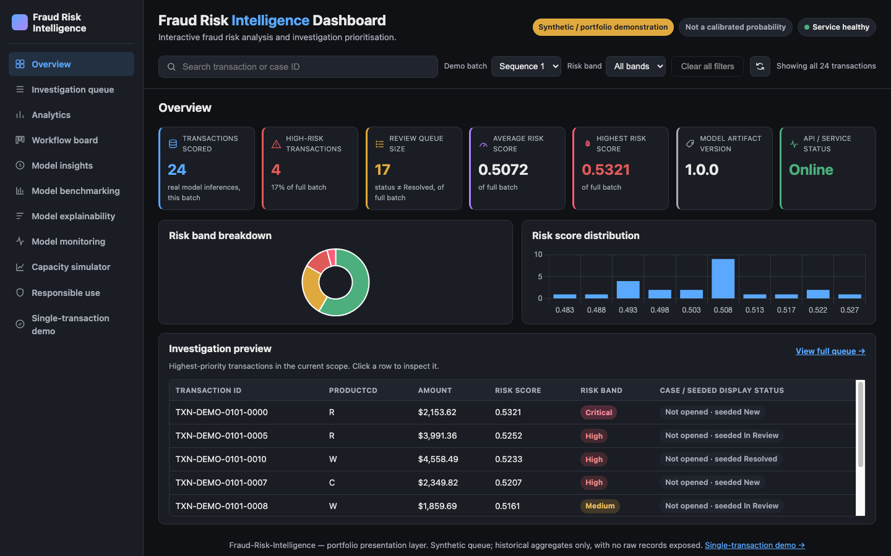
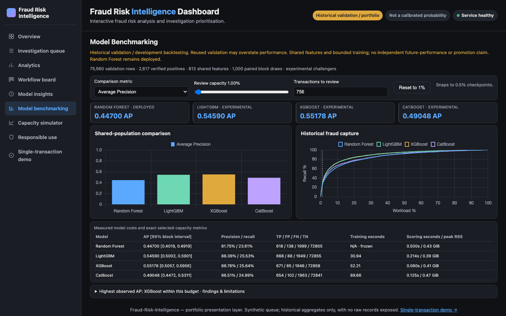
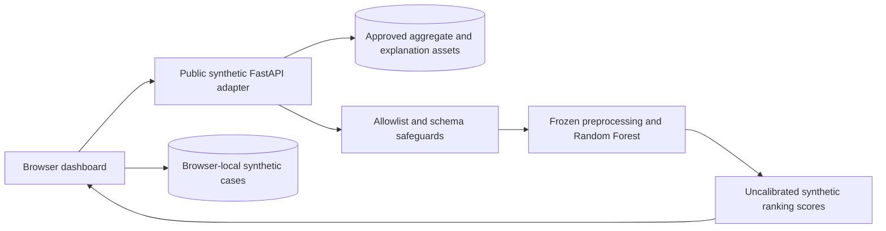

# Fraud Risk Intelligence

**A fraud-investigation prioritisation project: chronological ML evaluation, a frozen Random Forest and an interactive portfolio dashboard.**

The question is practical: **when investigators can review only a small fraction of transactions, which should they review first?** The application demonstrates ranking, workload trade-offs and human case review. It does not automatically reject payments or make fraud verdicts.

The original held-out evaluation reported **85.83% precision and 24.61% recall when reviewing the highest-ranked 1%**. This is a historical research result—not a measured banking outcome or a guarantee for the synthetic demonstration.

[Open the dashboard](https://fraud-risk-intelligence.onrender.com) · [5–7 minute walkthrough](docs/PORTFOLIO_WALKTHROUGH.md) · [Case study](docs/PORTFOLIO_CASE_STUDY.md) · [Architecture diagrams](docs/ARCHITECTURE.md)



*Stage 24 local desktop capture using the public synthetic adapter. Screenshots are versioned implementation evidence, not live service telemetry.*

## Business problem and objectives

An investigation queue has limited capacity. Reviewing more transactions may find more labelled fraud while increasing legitimate transactions sent for review. This project connects ranking quality to that workload decision for a simulated fraud analyst and risk manager.

- **Analytics:** inspect missingness, identity coverage, imbalance and temporal variation before modelling.
- **ML:** evaluate a leakage-aware, time-ordered ranking pipeline with Average Precision (AP) and precision/recall at review capacity.
- **Engineering:** serve a verified frozen artifact, translate evidence into an interactive dashboard and constrain the public demonstration to synthetic inputs and approved aggregates.

No real financial savings, customer outcomes, investigator productivity or professional banking deployment are claimed. Transaction amount is not verified net fraud loss. The [problem statement](docs/PROBLEM_STATEMENT.md) records the hypothetical business assumptions.

## Data and preparation

Source: [IEEE-CIS Fraud Detection on Kaggle](https://www.kaggle.com/competitions/ieee-fraud-detection/data), with competition data provided by Vesta. The labelled transaction table contains **590,540 rows and 394 columns**; its identity companion has **144,233 rows and 41 columns**. Identity records join by `TransactionID` and do not cover every transaction. Most feature meanings are anonymised, and `TransactionDT` is relative time, not a verified calendar date.

The repository does not redistribute the restricted raw data. The labelled population has approximately **3.5% fraud labels**, so plain accuracy would reward an unhelpful majority-class predictor. Dataset inspection, preprocessing and final evaluation use distinct scopes:

| Evidence layer | Population | Purpose |
|---|---|---|
| Original model training | Earliest 438,125 labelled records | Fit preprocessing and the selected model |
| Authorised validation | Next 75,560 records | Development, later capacity/benchmark research and historical monitoring |
| Closed final evaluation | Last 76,855 records | Original Stage 10 evaluation only; remains closed |
| Public dashboard transactions | Deterministic synthetic examples | Demonstrate scoring and investigation interactions |

Validation was reused during development; later validation results are not pristine out-of-sample model-selection evidence. The competition's separate unlabelled test files are not the project's closed labelled final-evaluation partition.

Checks cover schema differences, unique join keys, join coverage, missingness, duplicate IDs and chronological boundaries. The availability register excludes `TransactionID` and the target `isFraud`, and records unresolved point-in-time caveats for included inputs. Imputation values and encoder categories are fitted on training data only. See [data validation](docs/DATA_VALIDATION_REPORT.md), [EDA](docs/EDA_REPORT.md), [leakage boundaries](docs/LEAKAGE_BOUNDARIES_REPORT.md) and [preprocessing](docs/PREPROCESSING_REPORT.md).

## Original modelling and frozen artifact

Research progressed from baselines and tree pilots to an expanding-window chronological search. The selected configuration is a `RandomForestClassifier` with 100 trees, `max_depth=15`, `min_samples_leaf=5`, `max_features="sqrt"`, `class_weight=None` and `random_state=42`.

The serving pipeline uses **392 raw features**, with numeric median imputation, training-selected missingness indicators and categorical constant imputation/one-hot encoding. Its fitted schema contains **813 ordered transformed columns**. Column order is part of artifact identity. The Stage 6 engineered-feature prototypes were not adopted into this frozen pipeline.

The original Stage 10 fitted object was not saved. The serving artifact is a later reconstruction of the same frozen configuration/training procedure, independently checked for schema and prediction equivalence. The historical final-evaluation metrics below are **not a new evaluation of that joblib object**. Details: [tuning protocol](docs/STAGE9_TUNING_DESIGN_REPORT.md) and [production pipeline](docs/PRODUCTION_PIPELINE_REPORT.md).

Frozen artifact SHA256:

```text
2fb0cbc4457ec2e63ce235d5faee92c2812f3811c9efdf872760268d9122bf04
```

## Historical held-out results

These published **Stage 10** summary values concern the original authorised evaluation: **76,855 records, 2,682 positives**, scored once under that protocol. They are quoted from the [evaluation record](docs/STAGE10_EVALUATION_PROTOCOL.md), without reopening data or predictions.

| Metric | Historical result |
|---|---:|
| Average Precision | **0.42784** |
| ROC-AUC | **0.86637** |
| Precision at top 1% | **0.8583** |
| Recall at top 1% | **0.2461** |

AP summarises the precision–recall ranking across thresholds; it is not interchangeable with trapezoidal PR-AUC. At the 1% review budget, 769 records included 660 labelled positives. This supports a historical prioritisation argument, not automated declines, calibrated probabilities or projected savings. The CV-to-held-out gap has multiple plausible causes; the evidence does not isolate selection effects from temporal change or training-window differences.

## Challenger benchmarking

Stage 20 compares four models on **the same 75,560 validation records with 2,617 positives**, using a shared representation and bounded training protocol.

| Model | Validation AP | Validation ROC-AUC | Role |
|---|---:|---:|---|
| Random Forest | 0.44700 | 0.87333 | Frozen serving reference |
| LightGBM | 0.54590 | 0.90937 | Experimental challenger |
| XGBoost | 0.55178 | 0.91044 | Experimental challenger |
| CatBoost | 0.49048 | 0.87754 | Experimental challenger |

XGBoost has the highest observed AP in this experiment. Its small AP lead over LightGBM does not establish future or production superiority. There are **804 capacity checkpoints** and **1,000 paired chronological-block bootstrap draws over 20 blocks**. These are exploratory fixed-model intervals on reused validation, not independent future-performance guarantees. Shared one-hot features, limited tuning and convergence/resource budgets constrain the comparison. **Random Forest remains the serving model; no challenger is promoted.**

Do not compare this validation table directly with the Stage 10 final-evaluation table. [Benchmark protocol, uncertainty and reproducibility](docs/STAGE20_CHALLENGER_BENCHMARK.md).

## Investigation and evidence workspaces

| Feature | What it demonstrates | Boundary |
|---|---|---|
| Overview, queue and analytics | Synthetic scored transactions, shared filters and inspection | Scores/risk bands are not verified fraud outcomes |
| Capacity simulator | Review budget versus precision, recall and confusion counts across 201 checkpoints | Fixed reused historical validation; synthetic filters do not change that population |
| Model benchmarking | Same-population comparisons, capacity curves and uncertainty | Historical research; no automatic model promotion |
| Case management / workflow board | Open a case, assign a fictional analyst, set priority/status, record reasons, notes and history | Synthetic, browser-local; no authentication, shared database or bank integration |
| Model monitoring | Feature/score distributions, missingness and data-quality indicators | Historical validation windows; no live production feed or measured accuracy deterioration |
| Model explainability | Global MDI/TreeSHAP and signed synthetic local contributions | Model attribution, not causality, calibration or a fraud verdict |

### Investigation Capacity Simulator

The slider and numeric input select a historical review budget, with precision, recall and confusion counts from fixed checkpoints. At approximately 1% of validation, 756 reviews contain 618 labelled positives: **81.75% precision and 23.61% recall**. These reused-validation estimates may be optimistic; they are not the original final-evaluation result or synthetic queue outcomes. [Capacity methodology](docs/STAGE19_CAPACITY_SIMULATOR.md).

### Synthetic Case Management

Case Status, Analyst and Priority filters apply to **opened cases**. Unassigned means an opened case without a fictional analyst; an unopened transaction is not an unassigned case. Seeded display status is separate from an actual analyst case decision. Clearing filters preserves cases; **Reset Demo Cases** requires confirmation and discards the current demo scope's local changes. Storage is isolated by demo seed/batch scope, validated on load and remains editable outside the application—not a secure audit log. See [case management](docs/STAGE21_CASE_MANAGEMENT.md) and [queue corrections](docs/STAGE21_QUEUE_FILTER_CORRECTIONS.md).

### Historical Monitoring

Monitoring compares a fixed earliest-validation reference (**25,186 records**) with two later disjoint windows (**25,187 each**). PSI, descriptive KS distance, categorical Jensen–Shannon divergence and missingness changes use fixed investigation heuristics. Remaining below those rules is not evidence of unchanged accuracy. [Monitoring methodology and limitations](docs/STAGE22_MODEL_MONITORING.md).

### Model Explainability

Explainability maps all 813 transformed columns to 392 raw-feature groups. MDI means mean decrease in impurity. Global TreeSHAP uses **512 label-free validation examples**; signed contributions are grouped before taking mean absolute importance. **240 synthetic local explanations** reconcile to actual frozen-model outputs, with only **120 approved identifiers** exposed publicly. Assets are precomputed; public explanation requests do not run SHAP or unrestricted inference. [Explainability protocol and numerical verification](docs/STAGE23_MODEL_EXPLAINABILITY.md).

## Selected visual evidence

The existing captures below show implemented workspaces at their respective verification stages. Their navigation reflects the capture date; later views are documented separately. Open an image for full-size text.

| Workspace | Verified capture |
|---|---|
| Overview | [Current public-adapter synthetic batch](docs/stage24_portfolio_evidence/overview-1440x900.png) |
| Investigation Queue | [Opened case with combined filters](docs/stage21_queue_filter_evidence/queue-case-matching-1440x900.png) |
| Capacity simulator | [Historical review-capacity curves](docs/stage20_challenger_evidence/screenshots/capacity-1440x900.png) |
| Benchmarking | [Four-model comparison and limitations](docs/stage20_challenger_evidence/screenshots/benchmark-1440x900.png) |
| Case management | [Workflow with a matching opened case](docs/stage21_queue_filter_evidence/workflow-case-matching-1440x900.png) |
| Monitoring | [Historical feature-distribution comparison](docs/stage22_monitoring_evidence/monitoring-features-1440x900.png) |
| Explainability | [Grouped global and synthetic local TreeSHAP](docs/stage23_explainability_evidence/explainability-shap-1440x900.png) |



*Stage 20 evidence capture. These are reused-validation comparisons; Random Forest remains deployed.*

## Application architecture



The public adapter serves the dashboard and approved read-only evidence. Its constrained scoring routes use the frozen artifact on synthetic inputs; aggregate and explanation routes read precomputed assets. Case notes and assignments stay in the browser. The separate local prediction API supports schema-validated local inputs and is not the public deployment entry point.

[Offline ML pipeline and human investigation workflow diagrams](docs/ARCHITECTURE.md). [API contract](docs/STAGE14_API_REPORT.md) · [Public deployment safeguards](docs/RENDER_DEPLOYMENT_PREPARATION.md).

## Technology stack

- **Research and inference:** Python, pandas, NumPy, scikit-learn, SciPy and joblib.
- **Offline optional research:** LightGBM, XGBoost, CatBoost and TreeSHAP; these are not additional Render runtime requirements.
- **Application:** FastAPI, Uvicorn, HTML/CSS, JavaScript and Chart.js; browser-local storage for synthetic case state.
- **Verification and hosting:** pytest, real Chrome through the Chrome DevTools Protocol, Git/GitHub and Render Free.

There is no backend case database, live transaction stream or paid monitoring integration. Dependency sources: [minimal serving](requirements-render.txt), [research/test environment](requirements.txt), [optional challengers](requirements-benchmark.txt).

## Live demo

Visit [Fraud Risk Intelligence](https://fraud-risk-intelligence.onrender.com). The public service accepts only its approved synthetic scoring fixtures/batches and exposes approved aggregate evidence. Do not submit personal, payment or customer data. Case notes are local to that browser/device and are not transmitted to the scoring API.

The [Render Free service may spin down when idle](https://render.com/docs/free#spinning-down-on-idle); allow time for the first request to wake it. A service-status badge or screenshot is not an availability SLA.

## Running locally

**Use Python 3.12.15**, matching the artifact-producing environment. From the repository root on macOS/Linux:

```bash
git clone --branch render-dashboard-integration --single-branch https://github.com/gbeminiyiprecious721-cmd/Fraud-Risk-Intelligence.git
cd Fraud-Risk-Intelligence
python3.12 -m venv .venv
source .venv/bin/activate
python -m pip install -r requirements-render.txt
```

On Windows PowerShell, create/activate the environment with `py -3.12 -m venv .venv` and `.\.venv\Scripts\Activate.ps1`, then run the same `python -m pip` command. Use a Python 3.12.15 installation; do not upgrade pinned scientific packages to load this artifact.

**Artifact prerequisite:** obtain the exact trusted artifact from the owner and place it at `artifacts/frozen_rf_fraud_risk_v1.joblib`. It is intentionally not in this public repository. The public clone alone cannot run model-backed pages. Never load an untrusted joblib. Operators with authorised private-repository access can use the existing [artifact delivery script](deploy/render_fetch_artifact.sh); its required environment variables are documented there. Do not put tokens in commands, screenshots, Git or documentation. Do not rebuild/replace the frozen artifact as a setup shortcut.

Check the artifact, then launch the same constrained adapter used by the public demo:

```bash
python -c "import hashlib,json,pathlib; p=pathlib.Path('artifacts/frozen_rf_fraud_risk_v1.joblib'); expected=json.loads(p.with_name(p.name+'.manifest.json').read_text())['artifact_sha256']; actual=hashlib.sha256(p.read_bytes()).hexdigest(); assert actual == expected, 'Artifact checksum mismatch'; print(actual)"
python -m uvicorn src.render_demo:app --host 127.0.0.1 --port 8000
```

Open **http://127.0.0.1:8000/**. The same origin serves dashboard assets and API routes; a separate static server is unnecessary for this path. No raw historical data or challenger training is needed to serve the demo once the exact artifact is provisioned. Charts use the application's existing Chart.js asset-loading/fallback behaviour.

For authorised local research/testing, install `requirements.txt` in the project environment separately. Optional Stage 20 additions are pinned in `requirements-benchmark.txt` and documented with `--no-deps` in the [benchmark protocol](docs/STAGE20_CHALLENGER_BENCHMARK.md). Offline TreeSHAP tooling follows the [explainability protocol](docs/STAGE23_MODEL_EXPLAINABILITY.md). Neither is required for serving. Restricted historical datasets require separate Kaggle access; keep them under the existing gitignored data paths and never commit them.

## Testing and reproducibility

The fresh Stage 24 full regression run completed with **555 passed, zero failures/skips**, including **84 real-Chrome tests** and **all six heavy/data-contract tests**, with five inherited warnings. This is versioned local evidence, not a hosted CI claim. [Stage 24 verification and command scope](docs/STAGE24_PORTFOLIO_DOCUMENTATION.md).

In the existing authorised research/test environment:

```bash
python -m pytest tests/ -q
```

This includes browser and data-dependent tests: Chrome/Chromium must be installed, and historical train/validation inputs must be provisioned for the applicable checks. Heavy tests fit independent regression fixtures and can require substantial memory; they do not replace the frozen serving artifact. A minimal serving installation is not the complete test environment. Do not run scripts that reopen the closed final-test boundary.

For a smaller serving-contract check after installing the research/test requirements:

```bash
python -m pytest tests/test_render_demo.py tests/test_render_dashboard_integration.py -q
```

Scientific checks cover ordered schemas, artifact integrity, aggregate reconstruction, drift formulas, contribution reconciliation and public identifier restrictions. Browser tests cover navigation, responsive layouts, persistence and interactions. The [workflow record](docs/ML_WORKFLOW_STATE.md) preserves approvals and historical evidence; [Stage 24's evidence inventory](docs/STAGE24_PORTFOLIO_DOCUMENTATION.md) identifies the sources behind this README.

## Responsible AI and limitations

The data are imbalanced, anonymised and historical. Validation reuse limits later comparisons; temporal label availability remains uncertain. Scores—including the legacy API field named `fraud_probability`—are **uncalibrated model outputs**, not calibrated probabilities. Risk bands are relative demo rankings.

MDI has impurity/cardinality biases; TreeSHAP explains the fitted model under its documented path-dependent assumptions, not fraud causes. There is incomplete demographic fairness evidence and no fairness certification. Historical drift measures cannot establish current precision, recall or model decay without suitable new outcomes. Browser-local synthetic cases have no authentication, cross-device collaboration or tamper-proof audit trail. No verified financial savings or real-world fraud reduction have been measured. [Responsible AI assessment](docs/RESPONSIBLE_AI_ASSESSMENT.md).

## Future work

A genuine operational pilot would require separately approved prospective evaluation, point-in-time/label-maturity validation, calibration and fairness work, authenticated case governance and monitored access to legitimate production data. These are requirements for future work, not implemented integrations or an approved model-promotion plan.
