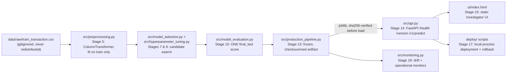

# Fraud Risk Intelligence

A fraud-detection decision-support system built on the IEEE-CIS Fraud Detection dataset, developed end to end through a 19-stage, stage-gated ML engineering process: business framing, data validation, EDA, leakage-safe splitting, preprocessing, feature engineering, model selection, experiment tracking, hyperparameter tuning, evaluation, explainability, a responsible-AI review, a production pipeline, a local API, a UI, automated testing, local deployment with a tested rollback, and local monitoring.

**All 19 stages are approved and closed.** The authoritative, continuously maintained record of every decision, result, and limitation is [`docs/ML_WORKFLOW_STATE.md`](docs/ML_WORKFLOW_STATE.md) — if anything in this README and that file ever disagree, the state file is correct.

This is a free/local portfolio project. It runs entirely on a single machine, with no cloud infrastructure, no paid service, and no public hosting. It demonstrates engineering discipline and methodology, not a production fraud-prevention system — see [Limitations, Responsible AI, and Future Work](#limitations-responsible-ai-and-future-work) before drawing any stronger conclusion from it.

---

## Table of contents

1. [Business problem and decision consumer](#business-problem-and-decision-consumer)
2. [Key findings and final evaluation results](#key-findings-and-final-evaluation-results)
3. [Dataset and its limitations](#dataset-and-its-limitations)
4. [End-to-end methodology](#end-to-end-methodology)
5. [Key scientific and engineering decisions](#key-scientific-and-engineering-decisions)
6. [Architecture and repository structure](#architecture-and-repository-structure)
7. [Local setup, testing, and reproduction](#local-setup-testing-and-reproduction)
8. [API and UI demonstration](#api-and-ui-demonstration)
9. [Limitations, responsible AI, and future work](#limitations-responsible-ai-and-future-work)
10. [Links to supporting technical evidence](#links-to-supporting-technical-evidence)

---

## Business problem and decision consumer

**Decision supported:** given a capacity-constrained human investigation queue, which transactions should be prioritized for review, to catch the most fraud per unit of investigation effort — not which transactions to automatically decline.

**Decision consumers**, as framed in [`docs/PROBLEM_STATEMENT.md`](docs/PROBLEM_STATEMENT.md):

| Consumer | Decision they make |
|---|---|
| Fraud operations analyst | Which held transactions to investigate first; a human makes the final call on every case |
| Fraud strategy / risk manager | Where to set the investigation-queue cutoff given current capacity and risk appetite |
| Finance / chargeback team | Bears the cost of a missed fraud (a false negative) |
| Customer experience / support | Bears the cost of an unnecessary investigation (a false positive) |

**Automated decline-at-checkout is explicitly out of scope.** It is noted only as a possible future extension, because it carries a materially different risk profile — no human in the loop, a higher bar for calibration and fairness evidence — and should never be assumed just because the same score could technically drive it. The model's output is a **risk score for ranking**, not a decision. See [API and UI demonstration](#api-and-ui-demonstration) for how that distinction is enforced in the actual interface.

Full reasoning, cost framing (three labelled, explicitly hypothetical sensitivity scenarios), and the dataset-relative definition of "investigation capacity": [`docs/PROBLEM_STATEMENT.md`](docs/PROBLEM_STATEMENT.md).

## Key findings and final evaluation results

**The one authorized, final-held-out-set result (Stage 10), scored exactly once, on `final_test` (76,855 rows, 2,682 positives, 3.49% prevalence):**

| Metric | Value |
|---|---|
| Average Precision (AP) | **0.42784** |
| ROC-AUC | 0.86637 |
| 95% bootstrap CI on AP (1,000 resamples) | **[0.40842, 0.44534]** |
| Precision@1% / Recall@1% | 0.8583 / 0.2461 |
| Precision@5% / Recall@5% | 0.3037 / 0.4351 |
| No-skill baseline (= prevalence) | 0.0349 |

This beats the no-skill baseline by +0.393 AP and clears both of Stage 1's stated success margins. Model: a frozen `RandomForestClassifier(n_estimators=100, max_depth=15, min_samples_leaf=5, max_features="sqrt", random_state=42, class_weight=None)`, trained once on the complete `train` partition (438,125 rows) via the approved Stage 5 preprocessing pipeline. Full detail, including two overclaims an independent audit caught and corrected in the original write-up (a misleading raw-AP subgroup comparison, and an over-strong "CV-to-final_test gap proves optimism" claim): [`docs/STAGE10_EVALUATION_PROTOCOL.md`](docs/STAGE10_EVALUATION_PROTOCOL.md).

**This single number is the end of a chain of *different*, non-interchangeable measurements — each one answers a different question, and none should be substituted for another:**

| Stage | Population | AP | What it actually measures |
|---|---|---|---|
| 7 | `validation` (75,560 rows) | 0.41101 | A full-`train`-fit Random Forest's performance on data it never trained on — the model-selection signal that chose "Random Forest" as a family |
| 9 | 5-fold chronological CV within `train` | 0.51236 (mean) | The hyperparameter-search signal that chose this exact configuration — never compared directly to `validation` or `final_test`, different population |
| 10 | `final_test` (76,855 rows) — **the only number above** | **0.42784** | The one, final, honest estimate of this exact configuration's performance on data touched exactly once |
| 11 / 12 | auxiliary fold-0 fit (73,020 rows) | 0.47545 | A SEPARATE fitted model, used only for SHAP/permutation-importance/subgroup analysis — never a project-level performance claim |

The gap between the CV mean (0.51236) and the final result (0.42784) is real and reported honestly, with **three distinct, co-plausible, undecomposed explanations** (search-selection effects, training-window/size differences, temporal population change) — not attributed to a single cause. See [`docs/STAGE9_TUNING_DESIGN_REPORT.md`](docs/STAGE9_TUNING_DESIGN_REPORT.md) and [`docs/STAGE10_EVALUATION_PROTOCOL.md`](docs/STAGE10_EVALUATION_PROTOCOL.md) §9.

**What this result does NOT establish** (stated here because it is as important as what it does establish): a calibrated real-world fraud probability (the score is an uncalibrated ranking signal — no calibration check has ever been performed), a demonstrated reduction in real financial loss, demographic fairness (this dataset has no protected demographic attribute), or that this configuration is a final, globally optimal model (Random Forest remains explicitly **provisional**; LightGBM/XGBoost/CatBoost were never installed or compared, by deliberate scope decision).

## Dataset and its limitations

[IEEE-CIS Fraud Detection](https://www.kaggle.com/competitions/ieee-fraud-detection) (Kaggle competition dataset, Vesta Corporation / IEEE Computational Intelligence Society). **Not redistributed in this repository** — see [Local setup, testing, and reproduction](#local-setup-testing-and-reproduction).

| File | Rows | Columns | Size | Notes |
|---|---|---|---|---|
| `train_transaction.csv` | 590,540 | 394 | 652 MB | Labelled (`isFraud`); `TransactionDT` is a relative time offset, not a confirmed calendar timestamp |
| `train_identity.csv` | 144,233 | 41 | 25 MB | Joins to `train_transaction` on `TransactionID`; 24.42% join coverage |
| `test_transaction.csv` / `test_identity.csv` | 506,691 / 141,907 | 393 / 41 | 585 MB / 25 MB | **Unlabelled** — Kaggle's own hold-out, never used by this project (this project builds its own labelled `train`/`validation`/`final_test` split entirely from `train_transaction.csv`) |

Verified fraud prevalence: **3.499%** (27.6 : 1 imbalance) — [`docs/EDA_REPORT.md`](docs/EDA_REPORT.md). Full discovery/validation evidence: [`docs/DATA_VALIDATION_REPORT.md`](docs/DATA_VALIDATION_REPORT.md).

**Real, material dataset limitations, carried through every later stage rather than resolved by assumption:**
- `TransactionDT`'s real-world meaning (relative offset vs. an actual confirmed timestamp) was never independently confirmed outside this dataset.
- No true customer/card identity exists in this anonymized dataset — `card1` alone is a weak proxy (one value covers ~2.65% of all rows); a `card1+card2+addr1` composite is structurally more defensible but still not a true 1:1 key.
- ~325 of the anonymized `V`-columns and all 14 `C`-columns were never individually verified for causal (non-leaky) computation — two narrow sanity checks passed for the `D`-columns, which is supporting evidence against specific failure modes, not proof.
- This dataset has **no legally or ethically protected demographic attribute** — a permanent, structural fact, not a gap this project could close. The Stage 12 subgroup analysis uses `ProductCD`/`card4`/`card6` (transaction/payment characteristics), explicitly never as demographic proxies.

## End-to-end methodology



Every arrow above is a real, approved stage boundary with its own written report and its own passing test suite — nothing upstream was ever treated as validated merely because a downstream stage ran without error.

| # | Stage | Status | Key evidence |
|---|---|---|---|
| 1 | Business Problem Definition | ✅ Approved | [`docs/PROBLEM_STATEMENT.md`](docs/PROBLEM_STATEMENT.md) |
| 2 | Dataset Discovery & Validation | ✅ Approved | [`docs/DATA_VALIDATION_REPORT.md`](docs/DATA_VALIDATION_REPORT.md) |
| 3 | Exploratory Data Analysis | ✅ Approved | [`docs/EDA_REPORT.md`](docs/EDA_REPORT.md), [`notebooks/01_exploratory_data_analysis.ipynb`](notebooks/01_exploratory_data_analysis.ipynb) |
| 4 | Leakage Boundaries & Data Splitting | ✅ Approved | [`docs/LEAKAGE_BOUNDARIES_REPORT.md`](docs/LEAKAGE_BOUNDARIES_REPORT.md), [`docs/feature_availability_register.csv`](docs/feature_availability_register.csv) |
| 5 | Preprocessing | ✅ Approved | [`docs/PREPROCESSING_REPORT.md`](docs/PREPROCESSING_REPORT.md) |
| 6 | Feature Engineering | ✅ Approved | [`docs/FEATURE_ENGINEERING_REPORT.md`](docs/FEATURE_ENGINEERING_REPORT.md), [`docs/engineered_features_register.csv`](docs/engineered_features_register.csv) |
| 7 | Model Selection | ✅ Approved | baselines + Random Forest/Gradient Boosting pilots + full-train RF benchmark — consolidated in [`docs/ML_WORKFLOW_STATE.md`](docs/ML_WORKFLOW_STATE.md) |
| 8 | Experiment Tracking | ✅ Approved | [`docs/EXPERIMENT_TRACKING_REPORT.md`](docs/EXPERIMENT_TRACKING_REPORT.md), [`docs/experiment_registry.jsonl`](docs/experiment_registry.jsonl) |
| 9 | Hyperparameter Tuning | ✅ Approved | [`docs/STAGE9_TUNING_DESIGN_REPORT.md`](docs/STAGE9_TUNING_DESIGN_REPORT.md) |
| 10 | Model Evaluation | ✅ Approved | [`docs/STAGE10_EVALUATION_PROTOCOL.md`](docs/STAGE10_EVALUATION_PROTOCOL.md) — the one `final_test` score |
| 11 | Explainability | ✅ Approved | [`docs/STAGE11_EXPLAINABILITY_REPORT.md`](docs/STAGE11_EXPLAINABILITY_REPORT.md) |
| 12 | Responsible AI Assessment | ✅ Approved | [`docs/RESPONSIBLE_AI_ASSESSMENT.md`](docs/RESPONSIBLE_AI_ASSESSMENT.md) |
| 13 | Production Pipeline | ✅ Approved | [`docs/PRODUCTION_PIPELINE_REPORT.md`](docs/PRODUCTION_PIPELINE_REPORT.md), [`src/production_pipeline.py`](src/production_pipeline.py) |
| 14 | API Development | ✅ Approved | [`docs/STAGE14_API_REPORT.md`](docs/STAGE14_API_REPORT.md), [`src/api.py`](src/api.py) |
| 15 | Application Integration | ✅ Approved | [`docs/STAGE15_APPLICATION_INTEGRATION_REPORT.md`](docs/STAGE15_APPLICATION_INTEGRATION_REPORT.md), [`ui/index.html`](ui/index.html) |
| 16 | Automated Testing | ✅ Approved | [`docs/STAGE16_AUTOMATED_TESTING_REPORT.md`](docs/STAGE16_AUTOMATED_TESTING_REPORT.md) |
| 17 | Deployment | ✅ Approved | [`docs/STAGE17_DEPLOYMENT_REPORT.md`](docs/STAGE17_DEPLOYMENT_REPORT.md), [`docs/STAGE17_ROLLBACK_RUNBOOK.md`](docs/STAGE17_ROLLBACK_RUNBOOK.md) |
| 18 | Monitoring Design | ✅ Approved | [`docs/STAGE18_MONITORING_REPORT.md`](docs/STAGE18_MONITORING_REPORT.md), [`docs/STAGE18_MONITORING_RUNBOOK.md`](docs/STAGE18_MONITORING_RUNBOOK.md) |
| 19 | Documentation & Portfolio | 🔶 This document — awaiting final review | this README |

A model that runs is not a model that has been evaluated: Stages 13–18 (production/API/app/testing/deployment/monitoring) only began after Stages 10–12 (Evaluation, Explainability, Responsible AI) were explicitly approved — never because inference technically worked.

## Key scientific and engineering decisions

**Why Average Precision, not accuracy or plain ROC-AUC.** The positive class is rare (3.499%) and the real decision is a *ranked* investigation queue — AP measures exactly how well the top of that ranking concentrates fraud, which accuracy cannot do under this imbalance (predicting "not fraud" for everything scores 96.5% accuracy) and plain ROC-AUC does not emphasize. AP's own no-skill floor equals the positive-class prevalence, not 0.5 — confirmed numerically (Stage 7's no-skill AP of 0.03463 matched the measured prevalence exactly), not assumed.

**Why chronological validation, not random k-fold.** `TransactionDT` gives this data a confirmed chronological structure; a model that unknowingly uses future information to predict the past would look better in cross-validation than it could ever perform in production. Every split in this project — the `train`/`validation`/`final_test` partition (Stage 4) and the 5-fold CV scheme (Stage 9) — is chronological (expanding-window), never a random shuffle.

**Why Random Forest, provisionally.** A 3-feature Logistic Regression baseline reached only 2.8x the no-skill floor; the full 813-feature Logistic Regression failed to converge under `liblinear` due to severe missingness-indicator multicollinearity, and `saga` converged but didn't resolve the underlying issue (closed as an inconclusive negative result, not a verdict against the family). Random Forest, trained on the complete `train` partition, reached AP 0.41101 on `validation` — independently re-verified. Full-data Gradient Boosting was assessed infeasible within a 600-second budget (a power-law fit from 3 measured points projected ~676s) and deliberately never run — a resource-budget decision, not a performance judgment. Random Forest was never declared the final or globally optimal choice; no LightGBM/XGBoost/CatBoost comparison exists.

**Why certain engineered features were never adopted.** All 11 Stage 6 engineered features (temporal phase, causal entity-history counts, frequency encoding, interaction/amount-derived features) remain marked `prototype_unvalidated` in [`docs/engineered_features_register.csv`](docs/engineered_features_register.csv) — their predictive contribution was explicitly deferred to a controlled ablation, never assumed, and the frozen Stage 13 artifact uses the Stage 5 preprocessing pipeline alone.

**Why `final_test` stayed sealed until exactly one Stage 10 evaluation.** A code-level guardrail (`get_partition()`/`assert_no_final_test_contamination()` in [`src/leakage_boundaries.py`](src/leakage_boundaries.py)) refuses `final_test` access without an explicit override — not a convention, an exception. That override was exercised exactly once, in Stage 10, and the registry's one `final_test` evaluation record is treated as immutable going forward (Stages 11 through 18 all reused existing saved results rather than re-scoring).

**Why model persistence and feature ordering mattered.** A real, independently-traced discrepancy (Stage 12) showed that reusing a different column ORDER for the same feature SET produced a different fitted `RandomForestClassifier(max_features="sqrt")` — because its random feature subsampling is position-dependent. This single finding is why [`src/production_pipeline.py`](src/production_pipeline.py)'s `FeatureSchema` treats the ordered transformed-feature list as part of a fitted artifact's identity, with its own order-sensitive checksum (`compute_ordered_schema_fingerprint`) — a fixed random seed alone does not guarantee reproducibility; fixing the entire input, including column order, does.

**Why the API returns an uncalibrated ranking score.** `fraud_probability` has never been checked against a reliability diagram, a Brier score, or any other calibration method — stated explicitly in the API response's own documentation (Stage 14) and reiterated at every later stage. It answers "is this transaction riskier than that one," never "this transaction has an X% chance of being fraud."

**Why monitoring drift is not the same as performance decay.** This project has no live transactions and no chargeback-label feed, so real accuracy decay cannot be measured locally. Stage 18's monitors instead track *proxies* — a shift in incoming feature distributions and a shift in the model's own output-score distribution, both via the Population Stability Index — and the report states explicitly, every time, that a drift alert is not an accuracy claim.

## Architecture and repository structure

```
Fraud-Risk-Intelligence/
├── README.md                          you are here
├── CLAUDE.md, AGENTS.md                cross-agent pointers to the live tracker
├── requirements.txt                    pinned environment manifest
├── pytest.ini                          test markers (heavy, data_contract_full)
├── data/raw/                           dataset (gitignored — see Local setup)
├── artifacts/
│   ├── frozen_rf_fraud_risk_v1.joblib              the one fitted model (gitignored, ~16MB)
│   └── frozen_rf_fraud_risk_v1.joblib.manifest.json  its sha256 + schema + provenance (git-tracked)
├── docs/
│   ├── ML_WORKFLOW_STATE.md            *** authoritative, live stage tracker ***
│   ├── PROBLEM_STATEMENT.md            Stage 1
│   ├── *_REPORT.md                     one report per stage (2 through 18)
│   ├── feature_availability_register.csv, engineered_features_register.csv
│   ├── experiment_registry.jsonl       every Stage 7-13 experiment, logged
│   ├── stage15_screenshots/            7 real browser screenshots (Stage 15)
│   └── _stage*_raw.json                generated evidence (gitignored)
├── src/                                one reusable module per stage
├── scripts/                            one real-data driver per stage (run_stageN_*.py)
├── tests/                              one pytest file per src module, 340 tests total
├── notebooks/                          Stage 3 EDA + Stage 11 explainability notebooks (executed, not hand-run)
├── ui/index.html                       Stage 15: static investigator UI (no build step)
├── deploy/                             Stage 17: local process-management deployment scripts
└── monitoring/                         Stage 18: versioned alert-rule config + reference distributions
```

**Production inference path** (the one code path every consumer uses — the API, the UI indirectly, and the Stage 17/18 demonstrations): `src/production_pipeline.py`'s `load_artifact()` (verifies the artifact's sha256 against its manifest before deserializing) → `predict_fraud_probability()` (delegates to the same preprocessing/model objects, never a second reimplementation).

## Local setup, testing, and reproduction

**1. Environment setup (lightweight, seconds):**
```bash
python3 -m venv .venv
source .venv/bin/activate
pip install -r requirements.txt
```
Python 3.12.15, pinned dependencies in [`requirements.txt`](requirements.txt): pandas 3.1.0, numpy 2.5.4, scikit-learn 1.9.1, scipy 1.18.1, matplotlib 3.11.2, pytest 9.1.1, shap 0.54.1 (Stage 11), fastapi 0.162.0 + uvicorn 0.54.0 (Stage 14). No deep-learning or gradient-boosting-specific library (LightGBM/XGBoost/CatBoost) is installed — a deliberate, documented scope boundary.

**2. Obtaining the data (manual, NOT automated by this repository):** download [IEEE-CIS Fraud Detection](https://www.kaggle.com/competitions/ieee-fraud-detection) from Kaggle and extract the five CSVs into `data/raw/ieee-fraud-detection/`. **The raw dataset (~1.3GB total) is gitignored and is never present after a fresh clone** — nothing in this repository claims otherwise.

**3. Fast automated tests (lightweight, ~7 seconds, no real data required for most of them):**
```bash
pytest tests/ -m "not heavy and not data_contract_full"
# 334 passed, 6 deselected
```

**4. Comprehensive automated tests (heavier — real data, a full model fit, ~2–3 minutes, ~16-20GB peak memory on this development machine):**
```bash
pytest tests/
# 340 passed (includes the Stage 13 full-training regression test and the Stage 16 full-train-partition data-contract scans)
```

**5. Building the fitted model artifact (heavy — real data required, one full `RandomForestClassifier` fit, ~51 seconds, ~16-17GB peak memory):**
```bash
.venv/bin/python3 scripts/build_stage13_artifact.py
```
**The artifact (`artifacts/frozen_rf_fraud_risk_v1.joblib`) is gitignored and does not exist after a fresh clone** — this command is how it is regenerated. Its sidecar manifest (git-tracked) records the exact checksum (`2fb0cbc4457ec2e63ce235d5faee92c2812f3811c9efdf872760268d9122bf04`) the current committed manifest expects; a freshly rebuilt artifact's checksum will differ byte-for-byte from the original (floating-point nondeterminism documented at Stage 7/10/13/16 under `n_jobs=-1`) even though its predictions are equivalent within `np.allclose` tolerance — rebuilding does not reproduce the identical bytes, only an equivalent model.

**6. Running the local API and UI (lightweight, once the artifact exists):**
```bash
.venv/bin/uvicorn src.api:app --host 127.0.0.1 --port 8000   # binds to 127.0.0.1 only, never 0.0.0.0
# in a second terminal, serve the static UI and open it in a browser:
cd ui && python3 -m http.server 8080
```

**7. Running the local deployment and monitoring demonstrations (heavier — real data + the artifact, local-only, no Docker on this machine):**
```bash
.venv/bin/python3 scripts/run_stage17_deployment_demo.py   # real local deploy + a genuine, executed rollback
.venv/bin/python3 scripts/run_stage18_monitoring_demo.py   # real control-vs-drift + operational monitoring demo
```

None of the commands above were run merely to produce this README — their already-recorded output (exact numbers, timings, and test counts) is cited throughout this document and traced to the specific report that measured it.

## API and UI demonstration

**API** ([`src/api.py`](src/api.py), Stage 14): three endpoints only — `GET /health`, `GET /version`, `POST /v1/predict` — serving the existing, trusted Stage 13 artifact. No training, no retraining, and no second preprocessing pathway exist anywhere behind these endpoints. Bound to `127.0.0.1` only, never a public interface, in every stage that uses it (14 through 18).

**UI** ([`ui/index.html`](ui/index.html), Stage 15): a single static HTML/CSS/vanilla-JS page, no framework, no build step. It calls the real local API with a fixed synthetic transaction and displays the returned score **rounded to two decimals with an always-visible "not a calibrated probability" caveat** — the interface never lets a user forget what the number actually is. One illustrative mockup element is visually and textually marked as fabricated, never presented as a real model capability.

**How an investigator would actually use this:** the score ranks a transaction relative to others in the queue; it never triggers an automatic decline or any other irreversible action. A human investigator reviews the highest-ranked transactions first, using their own judgment and whatever additional case information they have — the model's entire job is to make that triage more efficient, not to replace the human decision.

**Real browser verification evidence** (Stage 15, captured with the already-installed Chrome's headless screenshot mode — never fabricated):

| Screenshot | What it shows |
|---|---|
| [`docs/stage15_screenshots/01_ready_state.png`](docs/stage15_screenshots/01_ready_state.png) | Initial page load |
| [`docs/stage15_screenshots/02_success_after_click.png`](docs/stage15_screenshots/02_success_after_click.png) | A real score (0.52/1.00) returned by the real running API |
| [`docs/stage15_screenshots/03_error_invalid_payload.png`](docs/stage15_screenshots/03_error_invalid_payload.png) | A real 422 response, with no stale score left on screen |
| [`docs/stage15_screenshots/04_unavailable_api_down.png`](docs/stage15_screenshots/04_unavailable_api_down.png) | The API process genuinely killed mid-session; no stale or substituted score shown |
| [`docs/stage15_screenshots/05_retry_after_restore.png`](docs/stage15_screenshots/05_retry_after_restore.png) | A clean recovery after restart, identical score |
| [`docs/stage15_screenshots/06_keyboard_activation.png`](docs/stage15_screenshots/06_keyboard_activation.png) | Keyboard activation of the native button |
| [`docs/stage15_screenshots/07_focus_outline.png`](docs/stage15_screenshots/07_focus_outline.png) | The real, visible focus outline |

Full narrative and the one disclosed gap (synthetic keyboard events vs. literal human-hand interaction, never claimed as the same thing): [`docs/STAGE15_APPLICATION_INTEGRATION_REPORT.md`](docs/STAGE15_APPLICATION_INTEGRATION_REPORT.md) §11.

**Local deployment** ([`deploy/`](deploy/), Stage 17): Docker was checked for and confirmed **not installed** on the development machine, and was not installed without separate approval — a macOS local process-management approach (`start_release.sh`/`stop_release.sh`/`health_check.sh`) was used instead. A real, executed rollback exercise deployed a known-good release, deliberately deployed a disposable release with one checksum-corrupted artifact copy, detected the resulting readiness failure through an actual bounded health check (never assumed), and rolled back to a verified-identical known-good release. Full evidence: [`docs/STAGE17_DEPLOYMENT_REPORT.md`](docs/STAGE17_DEPLOYMENT_REPORT.md).

**Local monitoring** ([`src/monitoring.py`](src/monitoring.py), [`monitoring/config.json`](monitoring/config.json), Stage 18): batch, on-demand monitors — input-distribution drift (Population Stability Index against a real `train`-partition reference), prediction-score-distribution drift (scored by the real artifact, no refit), and operational log health. A real control batch raised no alerts; a real, deliberately shifted batch raised a genuine drift alert (PSI 7.421 on the input feature, PSI 0.696 on the resulting score distribution); Stage 17's own real failure evidence raised a genuine operational alert. This is local, run-on-demand monitoring, not a live production observability stack — see [`docs/STAGE18_MONITORING_REPORT.md`](docs/STAGE18_MONITORING_REPORT.md).

## Limitations, responsible AI, and future work

**This is a research/portfolio model, not a deployed production system.** The frozen artifact has been evaluated once on a held-out set, explained, assessed for responsible-AI concerns, packaged, served locally, deployed locally with a tested rollback, and monitored locally — every one of those words means exactly what Stages 10 through 18 actually did, and no more. In particular:

- **Local deployment ≠ cloud hosting.** Stage 17's "deployment" is a single process on one laptop, bound to `127.0.0.1`. It explicitly never claims to eliminate a single point of failure, and has no auto-restart, no load balancing, and no public reachability.
- **Synthetic/demo monitoring ≠ live monitoring.** Stage 18's control-vs-drift demonstration used real `train`-derived data and a real artifact, but on batches constructed for the demonstration, run on demand — there is no scheduler, no paging, and no continuously running monitor.
- **Input/prediction-distribution drift monitoring ≠ realized-accuracy monitoring.** This project has no live transactions and no ground-truth fraud-label feedback loop. A drift alert says a distribution shifted; it never says the model got less accurate, because that cannot be measured without real-world outcomes this project does not have.
- **Proposed recourse ≠ implemented recourse.** Stage 12's human-oversight-and-recourse process is a documented design recommendation, not a built feature.
- **Observable transaction subgroups ≠ protected-demographic fairness.** `ProductCD`/`card4`/`card6` subgroup breakdowns (Stage 12) are real, useful performance-breakdown evidence — this dataset has no demographic attribute at all, so no demographic-fairness claim is possible, and none is made.

Completing all 19 stages of this workflow demonstrates a disciplined *process*; it is not a production certification, a security audit, or a regulatory compliance review, and is never represented as one.

**Other carried-forward, real limitations** (full list, with every stage's own additions, in [`docs/ML_WORKFLOW_STATE.md`](docs/ML_WORKFLOW_STATE.md)'s Known Limitations section):
- Random Forest remains provisional — no gradient-boosting-specific library was ever installed or compared.
- The negative-`TransactionAmt` input-validation question has been named three times (Stages 12, 13, 14) and deliberately never resolved by inventing a rule not backed by evidence.
- No decision threshold is exposed anywhere in the API — only a raw, uncalibrated score, because no cost-justified threshold was ever approved (Stage 10's cost-sensitivity sweep stayed explicitly conditional).
- The existing API logs carry no wall-clock timestamp and never log artifact identity on error responses (audited and disclosed at Stage 18, not assumed).
- Physical mouse interaction and real screen-reader behavior remain unverified for the Stage 15 UI (only synthetic/programmatic interaction was tested).

**Prioritized future work** (named, not implemented):
1. A genuine cost-sensitive decision threshold, backed by real operational evidence rather than Stage 1's hypothetical sensitivity scenarios.
2. A comparison against a gradient-boosting model family, with an explicit approval round for the new dependency.
3. A real ground-truth feedback loop (even a delayed, partial one) to make realized-performance monitoring possible at all.
4. Calibration analysis (a reliability diagram, Brier score) before `fraud_probability` could ever be presented as an actual probability.
5. A process supervisor with restart-on-crash, if this project were ever extended toward a genuinely continuously-running local service.

## Links to supporting technical evidence

- [`docs/ML_WORKFLOW_STATE.md`](docs/ML_WORKFLOW_STATE.md) — the authoritative, live stage tracker; read this for the full, chronological decisions-and-justifications log, not this README.
- [`docs/HANDOFF.md`](docs/HANDOFF.md) — narrative handoff notes and known gotchas.
- Stage reports, in order: [`PROBLEM_STATEMENT.md`](docs/PROBLEM_STATEMENT.md) · [`DATA_VALIDATION_REPORT.md`](docs/DATA_VALIDATION_REPORT.md) · [`EDA_REPORT.md`](docs/EDA_REPORT.md) · [`LEAKAGE_BOUNDARIES_REPORT.md`](docs/LEAKAGE_BOUNDARIES_REPORT.md) · [`PREPROCESSING_REPORT.md`](docs/PREPROCESSING_REPORT.md) · [`FEATURE_ENGINEERING_REPORT.md`](docs/FEATURE_ENGINEERING_REPORT.md) · [`EXPERIMENT_TRACKING_REPORT.md`](docs/EXPERIMENT_TRACKING_REPORT.md) · [`STAGE9_TUNING_DESIGN_REPORT.md`](docs/STAGE9_TUNING_DESIGN_REPORT.md) · [`STAGE10_EVALUATION_PROTOCOL.md`](docs/STAGE10_EVALUATION_PROTOCOL.md) · [`STAGE11_EXPLAINABILITY_REPORT.md`](docs/STAGE11_EXPLAINABILITY_REPORT.md) · [`RESPONSIBLE_AI_ASSESSMENT.md`](docs/RESPONSIBLE_AI_ASSESSMENT.md) · [`PRODUCTION_PIPELINE_REPORT.md`](docs/PRODUCTION_PIPELINE_REPORT.md) · [`STAGE14_API_REPORT.md`](docs/STAGE14_API_REPORT.md) · [`STAGE15_APPLICATION_INTEGRATION_REPORT.md`](docs/STAGE15_APPLICATION_INTEGRATION_REPORT.md) · [`STAGE16_AUTOMATED_TESTING_REPORT.md`](docs/STAGE16_AUTOMATED_TESTING_REPORT.md) · [`STAGE17_DEPLOYMENT_REPORT.md`](docs/STAGE17_DEPLOYMENT_REPORT.md) · [`STAGE18_MONITORING_REPORT.md`](docs/STAGE18_MONITORING_REPORT.md)
- [`docs/feature_availability_register.csv`](docs/feature_availability_register.csv) · [`docs/engineered_features_register.csv`](docs/engineered_features_register.csv) — per-column leakage/availability traceability.
- [`docs/experiment_registry.jsonl`](docs/experiment_registry.jsonl) — every Stage 7–13 experiment, logged with its full configuration.
- [`docs/STAGE17_ROLLBACK_RUNBOOK.md`](docs/STAGE17_ROLLBACK_RUNBOOK.md) · [`docs/STAGE18_MONITORING_RUNBOOK.md`](docs/STAGE18_MONITORING_RUNBOOK.md) — operator-facing runbooks.
