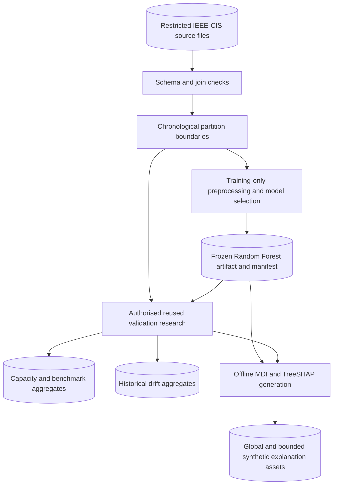
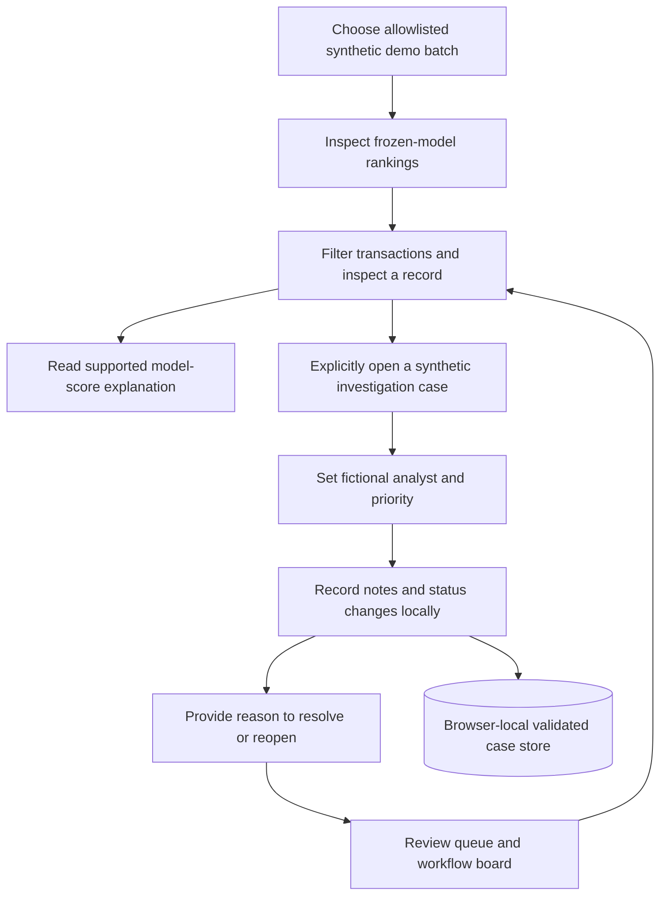

# Architecture — Fraud Risk Intelligence

These diagrams describe the implemented repository at the approved Stage 23
integration checkpoint. Research operates offline; public requests do not train
models, read historical rows or calculate SHAP. The third diagram—the application
runtime—is in the [README](../README.md#application-architecture), next to startup
instructions and the demo link.

## 1. End-to-end data and ML pipeline — offline

The closed final-evaluation partition is deliberately not an input to this
current research/asset-generation diagram. Its original Stage 10 evaluation is
preserved as a historical summary, not rerun. Train/validation membership comes
from the approved relative-time split. The public application receives approved
assets, not the historical rows. Challenger fits remain offline and do not replace
the frozen artifact. Synthetic local explanations additionally use the fixed
synthetic demo generator; they do not publish historical transaction explanations.

Sources: [leakage boundaries](LEAKAGE_BOUNDARIES_REPORT.md),
[production pipeline](PRODUCTION_PIPELINE_REPORT.md),
[benchmark protocol](STAGE20_CHALLENGER_BENCHMARK.md),
[monitoring protocol](STAGE22_MODEL_MONITORING.md),
[explainability protocol](STAGE23_MODEL_EXPLAINABILITY.md).

## 2. Investigation workflow — synthetic human decision support

A transaction is not a case until explicitly opened. Seeded display status does
not count as an analyst decision. Opened-case filters do not assign analysts or
priorities to unopened records. The application demonstrates an investigator's
workflow but does not verify fraud, block payments or communicate a decision to
a customer or bank. Resolution is a local synthetic case action.

Notes, assignments and activity history stay in browser-local storage, scoped
by demo seed/batch. Clearing filters does not delete those records. Confirmed
Reset Demo Cases discards local changes for its current scope. There is no
backend case-write endpoint, authenticated user identity or secure audit service.

Sources: [case management](STAGE21_CASE_MANAGEMENT.md),
[queue corrections](STAGE21_QUEUE_FILTER_CORRECTIONS.md).

## 3. Application deployment and inference — public runtime

See the [version-controlled runtime diagram](../README.md#application-architecture).
On Render, Uvicorn runs `src.render_demo:app`; this adapter serves the interface,
allowlisted synthetic scoring routes and approved aggregate lookup routes.
`src.api:app` is the distinct local prediction API and is not the public entry
point. Render fetches the owner-controlled artifact at build time, verifies its
committed manifest checksum and uses the existing minimal serving requirements.
The diagrams do not imply a database, live banking feed, background training or
runtime explanation computation.
